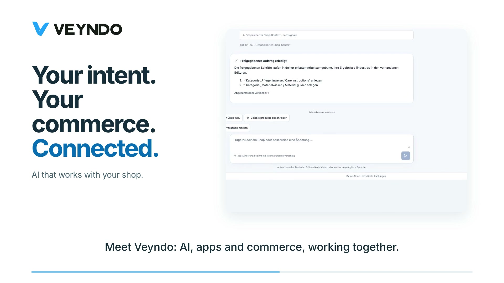

# Veyndo product films and video tours

**Product films, 24 October 2026.** Start with the AI overview, follow the connected merchant journey, then explore the app platform. All four films are Full HD, in English, with burned-in subtitles and no sound.

## AI commerce: your intent, your commerce, connected

**1:56 · English · 1080p · Silent · 24 October 2026**

A connected tour of shop context and knowledge, catalogue preparation from CSV/URLs/descriptions, design references, visual and agent-assisted app creation, reusable flows, fictional customer scenarios and shopping by intent. The final scenes explain the shared Rust core, private drafts and merchant control.

<video controls playsinline muted preload="none" poster="assets/showcase/ai-commerce-20261024/veyndo-ai-commerce.jpg" aria-label="Veyndo AI commerce" style="width:100%;height:auto;aspect-ratio:16/9;border-radius:16px">
<source src="assets/showcase/ai-commerce-20261024/veyndo-ai-commerce.mp4" type="video/mp4">
<track kind="captions" src="https://www.veyndo.ai/docs/assets/showcase/ai-commerce-20261024/veyndo-ai-commerce.en.vtt" srclang="en" label="English">
<a href="assets/showcase/ai-commerce-20261024/veyndo-ai-commerce.mp4">Watch or download the film</a>
</video>

[Download MP4](assets/showcase/ai-commerce-20261024/veyndo-ai-commerce.mp4) · [English captions](https://www.veyndo.ai/docs/assets/showcase/ai-commerce-20261024/veyndo-ai-commerce.en.vtt) · [Editable project](https://www.veyndo.ai/docs/assets/showcase/ai-commerce-20261024/editable-project.zip) · [Sources and encoding](assets/showcase/ai-commerce-20261024/README.md)

## The concept — commerce that thinks and acts

**1:12 · English · 1080p · Silent**

How the merchant agent, native Rust commerce core, apps and Storyfront shopping experiences fit together. Follow the embedded demo checkout through the receipt and back to an empty original bag.

<video controls playsinline preload="none" poster="assets/showcase/product-films-20261023/veyndo-concept.jpg" aria-label="The concept — commerce that thinks and acts" style="width:100%;height:auto;aspect-ratio:16/9;border-radius:16px">
<source src="assets/showcase/product-films-20261023/veyndo-concept.mp4?v=safari-20261024" type="video/mp4">
<track kind="captions" src="https://www.veyndo.ai/docs/assets/showcase/product-films-20261023/veyndo-concept.en.vtt" srclang="en" label="English">
<a href="assets/showcase/product-films-20261023/veyndo-concept.mp4">Watch or download the film</a>
</video>

[Download MP4](assets/showcase/product-films-20261023/veyndo-concept.mp4) · [English VTT](https://www.veyndo.ai/docs/assets/showcase/product-films-20261023/veyndo-concept.en.vtt) · [English SRT](https://www.veyndo.ai/docs/assets/showcase/product-films-20261023/veyndo-concept.en.srt)

## The connected merchant journey

**1:36 · English · 1080p · Silent**

Catalogue intake from CSV, descriptions or URLs; connected agent work; visual shop design; product selection; configured company approval and reorder; fictional customer scenarios.

<video controls playsinline preload="none" poster="assets/showcase/product-films-20261023/veyndo-workspace.jpg" aria-label="The connected merchant journey" style="width:100%;height:auto;aspect-ratio:16/9;border-radius:16px">
<source src="assets/showcase/product-films-20261023/veyndo-workspace.mp4?v=safari-20261024" type="video/mp4">
<track kind="captions" src="https://www.veyndo.ai/docs/assets/showcase/product-films-20261023/veyndo-workspace.en.vtt" srclang="en" label="English">
<a href="assets/showcase/product-films-20261023/veyndo-workspace.mp4">Watch or download the film</a>
</video>

[Download MP4](assets/showcase/product-films-20261023/veyndo-workspace.mp4) · [English VTT](https://www.veyndo.ai/docs/assets/showcase/product-films-20261023/veyndo-workspace.en.vtt) · [English SRT](https://www.veyndo.ai/docs/assets/showcase/product-films-20261023/veyndo-workspace.en.srt)

## The app platform — build connected capabilities

**1:24 · English · 1080p · Silent**

Visual editing and agent-assisted development, app-owned records and settings, shared native events, Veyndo AI/Codex/Claude Code entry points, private testing and versioned publication.

<video controls playsinline preload="none" poster="assets/showcase/product-films-20261023/veyndo-app-platform.jpg" aria-label="The app platform — build connected capabilities" style="width:100%;height:auto;aspect-ratio:16/9;border-radius:16px">
<source src="assets/showcase/product-films-20261023/veyndo-app-platform.mp4?v=safari-20261024" type="video/mp4">
<track kind="captions" src="https://www.veyndo.ai/docs/assets/showcase/product-films-20261023/veyndo-app-platform.en.vtt" srclang="en" label="English">
<a href="assets/showcase/product-films-20261023/veyndo-app-platform.mp4">Watch or download the film</a>
</video>

[Download MP4](assets/showcase/product-films-20261023/veyndo-app-platform.mp4) · [English VTT](https://www.veyndo.ai/docs/assets/showcase/product-films-20261023/veyndo-app-platform.en.vtt) · [English SRT](https://www.veyndo.ai/docs/assets/showcase/product-films-20261023/veyndo-app-platform.en.srt)

## Files and editable projects

[Download all three editable film projects](https://www.veyndo.ai/docs/assets/showcase/product-films-20261023/editable-projects.zip) · [Encoded-file metadata and hashes](https://www.veyndo.ai/docs/assets/showcase/product-films-20261023/manifest.json).

The films combine actual product captures from **15–22 October** with architecture illustrations and editorial focus moves. The captured interface is mostly German; the explanation is English. Demo data and simulated payments are shown. Film timing is not a latency measurement. These new films explain the implemented product; they do not replace the dated [software acceptance](status.md).

## Earlier workflow recordings — 13 October 2026

The following shorter tours keep their original capture dates and scope.

Fresh VEYNDO captures, 13 October 2026. The approved Living V identity and
"Commerce that thinks and acts." claim are used throughout. All data is synthetic.
Payments are simulated. Clips are silent, captioned and edited for readability;
they are not latency measurements or production-provider acceptance.

## Connected Commerce

[Watch the film](assets/showcase/connected-commerce.mp4) · [English captions](assets/showcase/connected-commerce.vtt)

One catalogue. Shared orders. Controlled business purchasing.

Actual UI screencast. A cash sale was recorded only in an isolated synthetic shop; no fiscal-device or external EDI delivery is demonstrated.

Duration: 38.3 seconds. Actual UI source: Core `5b2ebb5`.

## Build And Automate

[Watch the film](assets/showcase/build-and-automate.mp4) · [English captions](assets/showcase/build-and-automate.vtt)

Typed apps. Visible workflows. Deliberate releases.

Editorial sequence of fresh actual UI stills. An app draft version, an unsaved Flow edit and a selected product release are shown as distinct operations.

Duration: 29.0 seconds. Actual UI source: Core `5b2ebb5`.

## Connected Intelligence

[Watch the film](assets/showcase/connected-intelligence.mp4) · [English captions](assets/showcase/connected-intelligence.vtt)

Connected knowledge. Reviewed sources. Explicit limits.

Actual UI screencast of reviewed synthetic knowledge and explicit autonomy limits. No continuous business optimization or model training is demonstrated.

Duration: 50.4 seconds. Actual UI source: Core `5b2ebb5`.

## Checkout

[Watch the film](assets/showcase/checkout.mp4) · [English captions](assets/showcase/checkout.vtt)

Choose a variant. Review the order. Keep the experience connected.

Actual UI screencast with synthetic contact/address data and simulated authorization; no real payment.

Duration: 24.9 seconds. Actual UI source: Core `5b2ebb5`.

## App Studio

[Watch the film](assets/showcase/app-studio.mp4) · [English captions](assets/showcase/app-studio.vtt)

Design it. Test it privately. Save a version.

Actual UI screencast. The saved immutable app version is a draft, not a published package.

Duration: 44.6 seconds. Actual UI source: Core `5b2ebb5`.

## Knowledge

[Watch the film](assets/showcase/knowledge.mp4) · [English captions](assets/showcase/knowledge.vtt)

Connected knowledge. Reviewed sources. Explicit limits.

Actual UI screencast of a reviewed synthetic source. Price autonomy remains disabled; no model training is demonstrated.

Duration: 50.4 seconds. Actual UI source: Core `5b2ebb5`.

## Flows

[Watch the film](assets/showcase/flows.mp4) · [English captions](assets/showcase/flows.vtt)

Inspect execution traces. Design a reviewable flow. Publish deliberately.

Actual UI screencast. The edited branch is not saved; execution history belongs to existing saved flows.

Duration: 24.3 seconds. Actual UI source: Core `5b2ebb5`.

## Release

[Watch the film](assets/showcase/release.mp4) · [English captions](assets/showcase/release.vtt)

Private changes. Explicit review. Selected publication.

Editorial sequence of fresh actual UI stills. A selected product change was published in the synthetic shop; this does not show an app-package release.

Duration: 20.0 seconds. Actual UI source: Core `5b2ebb5`.

## Translations

[Watch the film](assets/showcase/translations.mp4) · [English captions](assets/showcase/translations.vtt)

One catalogue. Separate content languages. Explicit inheritance.

Actual UI screencast of existing English/German/French content. No translation-provider job was invoked.

Duration: 17.6 seconds. Actual UI source: Core `5b2ebb5`.

## Capture provenance

[File hashes, sizes and media metadata](assets/showcase/manifest.json) and
[chaptered tour provenance](assets/showcase/tours.json) identify the published files.
The captures were produced on the verified rebrand branch; their existence does
not establish that the branch has been merged or deployed. Raw recordings and
credentials are excluded from the public repository.

[Team briefing](https://team.veyndo.ai/#tours) · [Complete feature guide](features.md).
